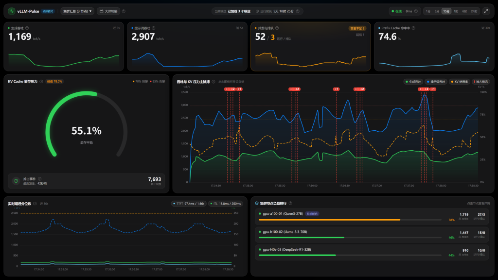
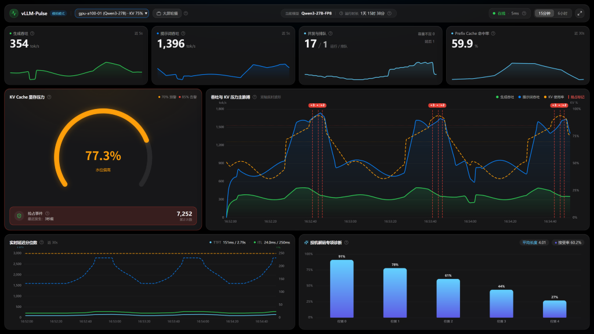
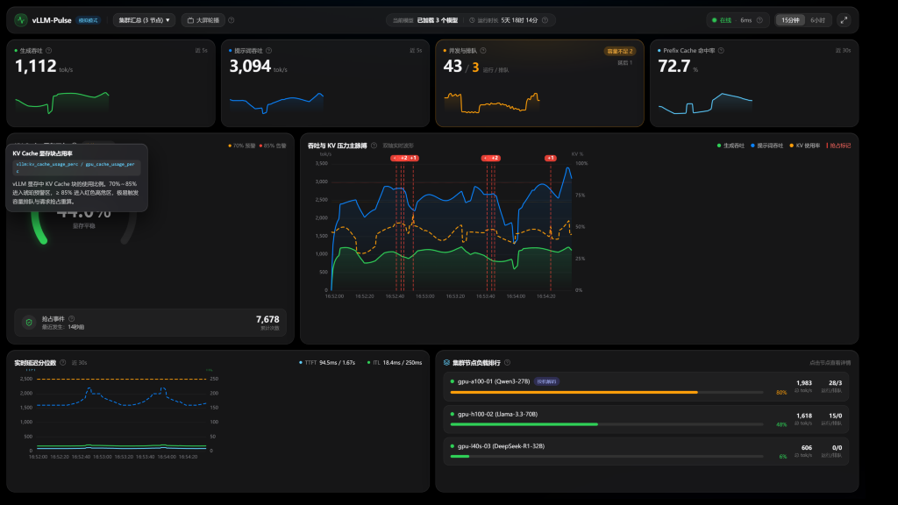
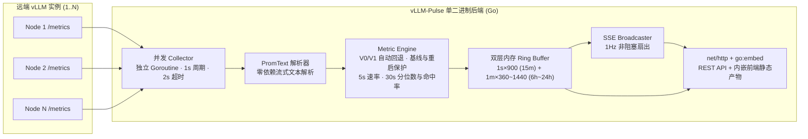

<div align="center">

# vLLM-Pulse

**专为 vLLM 打造的零依赖、单二进制实时推理监控大屏（Apple Pro Dark 风格）**

仅通过远程轮询 vLLM 原生 `/metrics`（Prometheus 文本格式）驱动 · 无需 Prometheus / Grafana / 数据库 · 单镜像 < 15 MB

[](https://github.com/wade6716/vLLM-Pulse/actions/workflows/ci-docker.yml)
[](https://go.dev/)
[](https://react.dev/)
[](https://github.com/wade6716/vLLM-Pulse/pkgs/container/vllm-pulse)
[](LICENSE)

[快速开始](#-快速开始) · [大屏预览](#-大屏效果预览) · [多节点配置](#-多节点配置与鉴权) · [架构与指标](#-系统架构与指标引擎) · [API 参考](#-http--sse-api-参考)

<br />



</div>

---

## 💡 为什么选择 vLLM-Pulse？

在日常 LLM 推理运维或压测现场，为了看清几台 vLLM 节点的实时吞吐、KV Cache 显存水位、抢占尖刺和 TTFT/ITL 延迟，往往需要部署一整套 `Prometheus + Grafana + Alertmanager + Node Exporter`。

**vLLM-Pulse** 将这一切极简为**单个 9 MB 可执行文件**：

| 对比维度 | 传统 Prometheus + Grafana 方案 | **vLLM-Pulse** |
| --- | --- | --- |
| **部署复杂度** | 需维护 TSDB、采集器、Dashboard JSON 模板 | **单二进制 / 单容器开箱即用**，零外部依赖 |
| **资源与镜像体积** | 数百 MB 镜像 + 持续磁盘 IO | **静态 Go 二进制 ~9 MB**，多阶段 `scratch` 镜像 < 15 MB |
| **实时刷新体验** | 默认 15s~30s 抓取间隔，图表刷新卡顿 | **1s 并发采集 + SSE 增量推流**，毫秒级丝滑波形 |
| **vLLM 深度语义** | 需手写复杂 PromQL 兼容 V0/V1 指标与重启尖刺 | **原生兼容 V0/V1**，内置首次基线归零、重启保护、投机解码自动探测 |
| **大屏观感** | 通用仪表盘易拥挤、易出现滚动条 | **16:9 锁定无滚动条 + Apple Pro Dark**，内置指标悬浮解释 |

---

## ✨ 核心特性

* **纯远程指标驱动，安全隔离**：仅通过 HTTP GET 拉取远端 vLLM `/metrics`，**严禁**依赖宿主机 `nvidia-smi`、`/proc` 或本地 Agent；同时避免浏览器直连 vLLM 导致的跨域与多客户端重复压测问题。
* **零数据库内存 Ring Buffer**：每节点内置双层定长环形缓冲——**1s 高频环（15 分钟 / 900 点，支持 `1分 / 5分 / 15分` 秒级窗）**用于毫秒级实时波形与 30s 滑窗计算，**1m 降采样环（默认保留 24 小时，支持 `1时 / 6时 / 24时` 趋势窗）**，外加精确抢占事件环。
* **vLLM V0 / V1 全自动兼容与防呆保护**：
  * 自动兼容 `kv_cache_usage_perc` / `gpu_cache_usage_perc`、`prefix_cache_*` / `gpu_prefix_cache_*`、`inter_token_latency_seconds_bucket` / `time_per_output_token_seconds_bucket` 与多 `engine` 标签聚合。
  * **首次采集基线归零**（防止将历史累计抢占/Token 误判为瞬时暴增）与 **容器重启重置保护**（识别 `curr < prev` 或 `*_created` 变更，彻底消除负值尖刺）。
* **Apple Pro Dark 视觉美学与指标自解释**：
  * 纯黑曜石基底搭配 macOS 毛玻璃卡片、Apple Watch 开放式 KV 压力圆环、双 Y 轴 TTFT/ITL 延迟对比曲线与强制 `tabular-nums` 等宽数字。
  * **Calm UI 异常唤醒**：KV ≥ 70% 琥珀预警、≥ 85% 红色高危、`waiting(capacity) > 0` 队列高亮，抢占发生时触发红色呼吸脉冲并在主波形打上垂直 `MarkLine`。
  * **内置 `InfoTip` 指标词典**：每个指标旁均配有 `?` 悬浮说明（基于 Portal 渲染），悬停即可查看计算公式、滑窗口径与对应 Prometheus 指标名。
* **多节点 TV 轮播与异常锁定**：开启大屏轮播后每 30 秒自动巡检节点；一旦某节点发生抢占、`KV ≥ 85%` 或容量排队，大屏立即跳转并锁定该节点，恢复平稳后自动继续轮播。
* **内置 `--mock` 仿真模式**：无需真实 GPU 即可模拟正常推理、KV 飙升至 90%+、抢占尖刺、Prefix Cache `空闲` 态以及投机解码逐位置接受率。

---

## 📸 大屏效果预览

### 1. 多节点投机解码诊断与 KV 预警态（`Qwen3-27B-FP8`）
自动探测到 `vllm:spec_decode_*` 指标时激活右下角专项诊断面板，展示平均接受长度与逐 Draft 位置接受率柱状图；右侧双轴延迟图表分别用左/右 Y 轴清晰呈现 `TTFT` 与 `ITL`。



### 2. 内置指标词典悬浮窗与容量排队高亮
鼠标悬停任意指标旁的 `?` 图标，即可通过 macOS 毛玻璃浮窗查看该指标的精确计算逻辑、滑窗大小与告警阈值；当 `容量不足` 排队大于 0 时，对应 KPI 卡与集群排行条自动点亮警示色。



---

## 🚀 快速开始

### 方式一：Docker 一键体验（推荐）

GitHub Actions 每次推送都会自动构建多架构超轻量 `scratch` 镜像（`linux/amd64` & `linux/arm64`）并发布至 GHCR：

```bash
# 使用内置 3 节点 Mock 数据立即预览大屏（无需 GPU）
docker run -d --name vllm-pulse -p 8080:8080 \
  ghcr.io/wade6716/vllm-pulse:latest --mock --port 8080
```

浏览器打开 **`http://localhost:8080`** 即可访问。

如监控真实 vLLM 节点，可通过 CLI 参数或挂载配置文件启动：

```bash
# 单节点快速接入
docker run -d --name vllm-pulse -p 8080:8080 \
  ghcr.io/wade6716/vllm-pulse:latest --target http://10.0.1.10:11435/metrics

# 多节点 YAML 配置挂载
docker run -d --name vllm-pulse -p 8080:8080 \
  -e VLLM_API_KEY="your-secret-token" \
  -v $(pwd)/configs/config.example.yaml:/etc/vllm-pulse/config.yaml:ro \
  ghcr.io/wade6716/vllm-pulse:latest --config /etc/vllm-pulse/config.yaml
```

也支持直接使用仓库自带的 [docker-compose.yml](docker-compose.yml)：

```bash
docker compose up -d
```

### 方式二：单二进制 CLI 运行

从 [GitHub Releases](https://github.com/wade6716/vLLM-Pulse/releases) 下载对应平台二进制（或本地自行编译）后直接运行：

```bash
# 1. Mock 演示模式
./vllm-pulse --mock --port 8080

# 2. 监控单个 vLLM 实例
./vllm-pulse --target http://host1:11435/metrics --port 8080

# 3. 监控多个 vLLM 实例
./vllm-pulse \
  --target http://host1:11435/metrics \
  --target http://host2:8000/metrics \
  --port 8080

# 4. 使用 YAML 配置文件
./vllm-pulse --config configs/config.example.yaml
```

### CLI 参数一览

| 参数 | 默认值 | 说明 |
| --- | --- | --- |
| `--mock` | `false` | 启动内置 3 节点仿真数据源（含投机解码、抢占尖刺、空闲态） |
| `--target` | — | 目标 vLLM `/metrics` URL（可重复传入多个） |
| `--config` | — | YAML 配置文件路径 |
| `--host` | `0.0.0.0` | HTTP 服务监听地址 |
| `--port` | `8080` | HTTP 服务监听端口 |
| `--interval` | `1s` | 指标轮询与 SSE 推送间隔（支持 Go Duration 格式，最低 `200ms`） |
| `--timeout` | `2s` | 单节点单次 `/metrics` HTTP 请求超时时间 |
| `--retention-hours` | `24` | 1 分钟降采样环保留时长（范围 `6` ~ `24` 小时） |

---

## ⚙️ 多节点配置与鉴权

参考 [configs/config.example.yaml](configs/config.example.yaml)，支持自定义节点别名、反向代理自定义 HTTP Header 及 `${ENV_VAR}` 环境变量展开：

```yaml
server:
  host: 0.0.0.0
  port: 8080

scrape:
  interval: 1s
  timeout: 2s

# 1 分钟降采样环保留时长（6 ~ 24 小时）
retention_hours: 24

nodes:
  - id: qwen3-a100
    name: "gpu-a100-01 (Qwen3-27B)"
    url: "http://10.0.1.10:11435/metrics"
    headers:
      Authorization: "Bearer ${VLLM_API_KEY}"

  - id: llama3-h100
    name: "gpu-h100-02 (Llama-3.3-70B)"
    url: "http://10.0.1.11:8000/metrics"
    headers:
      X-Cluster-Token: "${VLLM_CLUSTER_TOKEN}"

  - name: "gpu-l40s-03 (DeepSeek-R1)"
    url: "http://10.0.1.12:8000/metrics"
```

> [!TIP]
> 在非 Mock 模式下，点击大屏顶部节点下拉框旁的 `+` 按钮，还可在页面上动态增删临时监控节点（无需重启服务）。

---

## 🏗️ 系统架构与指标引擎



### 支持的 vLLM 指标与换算规则

| 业务指标 | 兼容指标名（优先前者，自动回退后者） | 计算规则与告警阈值 |
| --- | --- | --- |
| **运行中请求** | `vllm:num_requests_running` | Gauge 按同节点所有 `engine` 求和 |
| **排队请求** | `vllm:num_requests_waiting`<br>`vllm:num_requests_waiting_by_reason` | 拆分 `capacity`（容量不足）与 `deferred`（延后）；`capacity > 0` 触发高亮预警 |
| **KV Cache 使用率** | `vllm:kv_cache_usage_perc`<br>`vllm:gpu_cache_usage_perc` | 按 `engine` 取均值并转为 `0~100%`；`70%~85%` 琥珀预警，`≥ 85%` 红色高危 |
| **抢占事件与运行时长** | `vllm:num_preemptions_total`<br>`vllm:num_preemptions_created` | 计算周期增量 `Δpreemptions` 与累计总数；`Δ > 0` 触发脉冲与 `MarkLine`；由 `*_created` 推算 Uptime |
| **生成 / 提示词吞吐** | `vllm:generation_tokens_total`<br>`vllm:prompt_tokens_total` | **近 5s 滑动窗口**累计增量换算速率（`tok/s`） |
| **Prefix Cache 命中率** | `vllm:prefix_cache_{hits,queries}_total`<br>`vllm:gpu_prefix_cache_{hits,queries}_total` | **近 30s 滑动窗口** `Δhits / Δqueries × 100%`；`Δqueries == 0` 标记为 `空闲` |
| **TTFT / ITL 延迟** | `vllm:time_to_first_token_seconds_bucket`<br>`vllm:inter_token_latency_seconds_bucket` / `time_per_output_token_seconds_bucket` | **近 30s 滑动窗口桶差值**，按 Prometheus `histogram_quantile` 算法线性插值输出 P50 / P95（ms） |
| **投机解码（自动探测）** | `vllm:spec_decode_*` | 自动识别并计算平均接受长度、总体接受率与各 Draft 位置接受率分布 |

---

## 🔌 HTTP & SSE API 参考

| 方法与路径 | 说明 |
| --- | --- |
| `GET /api/health` | 健康检查，返回运行状态与是否处于 `--mock` 模式 |
| `GET /api/nodes` | 返回所有节点摘要、集群汇总摘要及健康状态 |
| `GET /api/snapshot?node={id\|all}&range=1m\|5m\|15m\|1h\|6h\|24h` | 返回指定节点（或 `all` 集群聚合）的历史 Ring Buffer 快照与抢占事件列表 |
| `GET /api/stream` | SSE 长连接（`event: tick`），每秒推送全节点与集群最新状态帧 |
| `POST /api/nodes` | 运行时动态添加临时监控节点（请求体 `{ name, url, headers }`） |
| `DELETE /api/nodes/{id}` | 运行时移除动态添加的临时监控节点 |

---

## 🛠️ 本地开发与单二进制构建

**环境要求**：Go `1.24+`、Node.js `22+`

### 一键编译单二进制

```bash
# Linux / macOS
make build

# Windows PowerShell
.\scripts\build.ps1
```

构建完成后会在仓库根目录生成内嵌全部前端资源的单个可执行文件（`vllm-pulse` / `vllm-pulse.exe`，体积约 9 MB）。

### 前端开发热更新联调

```bash
# 终端 1：启动后端 Mock 服务
go run ./cmd/vllm-pulse --mock --port 8080

# 终端 2：启动 Vite 热更新开发服务器（自动代理 /api 到 :8080）
cd web && npm install && npm run dev
```

### 运行测试

```bash
# 前端类型检查
cd web && npm run typecheck

# 后端单元测试（覆盖首次基线归零、重启重置、分位数线性插值、除零保护等）
go test -v -race ./...
```

---

## 📄 开源协议

本项目基于 [MIT License](LICENSE) 开源。
